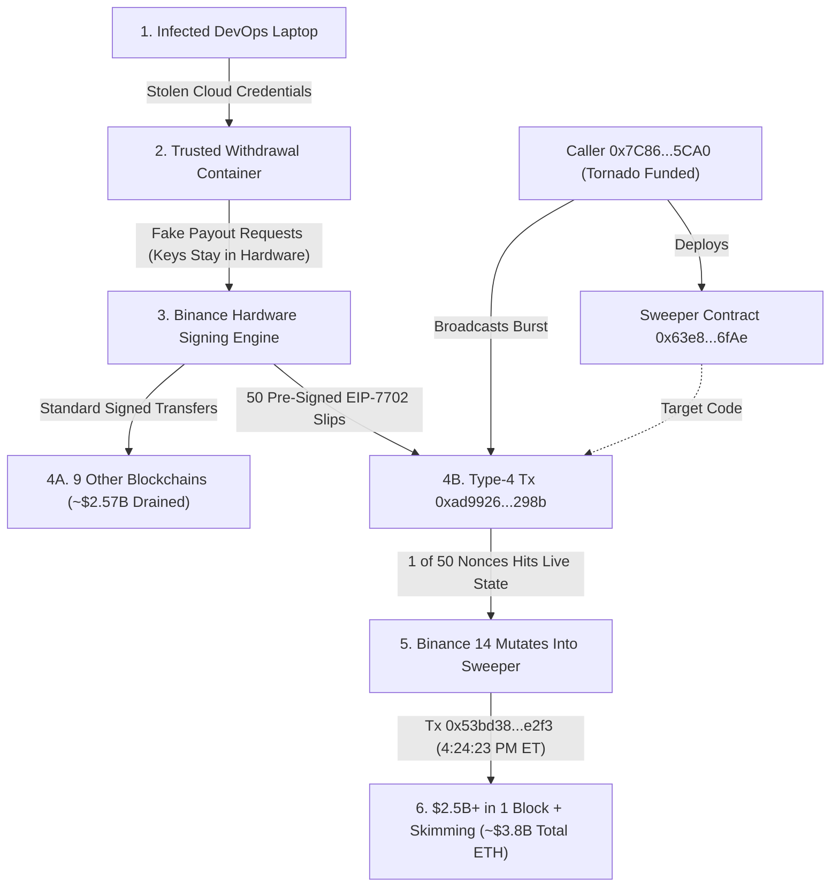

import {
  CastDossierCards,
  ConceptGlossaryExplorer,
  HeistTimelineSimulator,
  SigningCoercionVisualizer,
  Eip7702ExploitSimulator,
  AttributionScaleExplorer,
  MoneyTrailExplorer,
  FreezeAndLaunderingFlow,
  MarketShockwavePanel,
  DefenseSimulator,
  IocCopyVault,
  BriefingSummaryCard,
} from "@/components/cyber/BinanceHeistVisuals";

At 4:04 PM Eastern Time on Thursday, October 29, 2026, the global crypto market was drifting toward a quiet autumn evening. Trading desks in New York were packing up. Engineers across Singapore and Tokyo were either asleep or pouring their first cup of coffee.

Inside the cloud servers of **Binance**, the largest cryptocurrency exchange on earth, automated payout queues hummed steadily. Every few seconds, internal software checked customer balances and stamped digital signatures onto routine withdrawals.

Sixty seconds later, the floor dropped out.

At **4:05 PM ET**, operational Binance accounts on the XRP Ledger suddenly sent **233.46 million XRP ($296 million)** to an unknown wallet. Before security analysts could tell whether they were looking at a rich trader cashing out or an intrusion, several more blockchains lit up within minutes.

Eighteen thousand Bitcoins vanished. Hundreds of millions in digital dollars poured off Tron and Solana.

Then, at **4:20:59 PM ET**, a single unusual transaction landed on Ethereum. It fired fifty pre-signed digital permission slips at Binance's richest operational account in one burst. Forty-nine bounced off harmlessly. One clicked into place.

Three minutes and twenty-four seconds later, that single account emptied **more than $2.5 billion** in one block.

> **"4:05 PM ET to 4:25 PM ET, October 29, 2026"**
> _During the primary blitz, money left Binance at **more than $300 million per minute**, or roughly **$5 million every single second**._

Nobody cracked encryption with a quantum computer. Nobody smuggled a master private key out on a thumb drive. Instead, intruders infected an engineer's laptop, slipped inside an internal software container, and tricked Binance's own signing machine into approving what analysts on _Sky News_ called _"the largest bank heist in human history."_

---

## Cast of Characters

Eight key players shaped the seventy-two hours between the first stolen token and the reopening of customer withdrawals. Explore each player's role in the interactive dossier below:

<CastDossierCards />

---

## 1. Executive Summary

On **October 29, 2026**, starting at **4:05 PM ET**, attackers drained **$6.36 billion** (**$6.3B to $6.4B** across forensic trackers) from **Binance** across ten blockchains. Most of the money disappeared in roughly twenty minutes, more than quadrupling the **$1.5 billion** Bybit theft of February 2025.

No private keys were stolen. Instead, intruders compromised a DevOps engineer's laptop, pivoted into a withdrawal-submission container, and fed fraudulent payout instructions into Binance's signing pipeline. On Ethereum (**$3.8 billion** stolen), they abused **EIP-7702**, firing fifty pre-signed authorizations to turn a flagship hot wallet into an automated sweeper contract.

Emergency blacklists by **Tether**, **Circle**, and network councils froze **$2.7 billion to $3.0 billion** within roughly a day, while **$3.36 billion to $3.66 billion** in unfreezable Bitcoin and Ether escaped. **TRM Labs**, **Chainalysis**, and U.S. federal agencies (**FBI**, **U.S. Secret Service**, **IRS-CI**) attributed the attack with high confidence (suspected/attributed) to North Korea's **TraderTraitor** unit. Binance covered user balances from corporate reserves, averting collapse while forcing an industry-wide custody reckoning.

If terms like _hot wallet_, _nonce_, or _EIP-7702_ are new to you, tap through this sixty-second visual decoder first:

<ConceptGlossaryExplorer />

---

## 2. The Day the Money Moved: Incident Timeline

Big heists never start when the alarm goes off. Thirty-six hours before any public dashboard flashed red on Thursday afternoon, the attackers were already fueling their getaway wallets and rehearsing their code on live blockchains.

Press **Auto-Play** or step forward through each timestamp in the simulator below to watch the ten-chain blitz, the thirty-seven-minute DeFi escape race, and the multi-billion-dollar freezes unfold in real time:

<HeistTimelineSimulator />

### Phase 1: The Dress Rehearsal (~36 Hours Before)

Early on **Wednesday, October 28, 2026**, a fresh Ethereum address (`0x7C8601d4645b93cea45F71e118A729332e6B5CA0`) received small amounts of Ether to pay future transaction fees ("gas"). That seed money came out of **Tornado Cash**, an on-chain **mixer** (a privacy pool that blends deposits from thousands of users together so investigators cannot trace where a withdrawal originated).

That same operator then deployed a custom **smart contract** (`0x63e842B054Bd624a465454D533C33F573e9c6fAe`). Think of a smart contract as a small, self-running computer program stored permanently on a blockchain: send it a trigger signal, and it moves money automatically with no human middleman.

Over the next day and a half, forensics from TRM Labs and Blockaid caught the operators testing this program against disposable test wallets. Why rehearse? When you only get one shot at a multi-billion-dollar vault, a tiny coding bug or a miscalculated gas limit will cause the entire transaction to fail.

Inside Binance, quiet preparation was also complete. Starting from an infected software engineer's laptop, the intruders had reached the internal software container that queues payouts from Binance's **hot wallets**. Unlike offline **cold storage** vaults locked away without internet access, hot wallets stay connected to the internet like cash drawers behind a bank teller's window so customers can withdraw money in seconds.

### Phase 2: Twenty Minutes Across Ten Blockchains (4:05 PM – 4:25 PM ET)

Why rob ten blockchains at the exact same time? Because the instant an exchange's security team spots stolen funds leaving one network, they slam a master kill switch across every other network in the building. If the attackers moved sequentially, they might have walked away with one chain instead of ten.

At **4:05 PM ET (20:05 UTC)** on October 29, the XRP Ledger fired first. Multiple Binance hot wallets abruptly consolidated **233.46 million XRP ($296 million)** into a single external account.

Seconds later, valid cryptographic signatures began clearing everywhere at once:

- **Bitcoin:** **18,270 BTC** (worth roughly **$1.47 billion to $1.50 billion**) slid out into fresh attacker wallets.
- **Tron:** **$628 million** exited, mostly as **612.7 million USDT** alongside **46.4 million TRX**.
- **Solana & Layer-2 Networks:** Nearly **970,500 SOL ($96 million)** drained from Solana, while **Arbitrum, Optimism, and Base** lost **$39 million** combined.

Yet the crown jewel sat waiting on Ethereum mainnet inside a famous operational account labeled **Binance 14** (`0x28C6c06298d514Db089934071355E5743bf21d60`).

`Binance 14` held native Ether plus more than sixty separate token balances. Draining sixty tokens one withdrawal at a time would take too long and risk tripping automated rate limiters. So at **4:20:59 PM ET (20:20:59 UTC)**, external caller `0x7C86...5CA0` broadcast transaction `0xad99264d5532ae0dd04b2004eebda05f25657e70dacb764f7ac8d4ccd051298b`, packing **50 pre-signed EIP-7702 permission slips** into one envelope.

One slip matched `Binance 14`'s live counter, grafting the attackers' rehearsed sweeper program straight onto Binance's wallet. At **4:24:23 PM ET (20:24:23 UTC)**, transaction `0x53bd38b816c23e74134786c29a8c18d792777998a3b9326047b583100e88e2f3` pulled the trigger.

> **"4:24:23 PM ET (20:24:23 UTC): The $2.5 Billion Block"**
> _In a single Ethereum transaction, `Binance 14` handed over **167,464 ETH**, **1.615 billion USDT**, and **63 other ERC-20 tokens**, marking the largest single-transaction theft in crypto history._

### Phase 3: The 37-Minute Freeze Race & Evening Aftershocks (4:25 PM – 8:10 PM ET)

The moment `0x53bd38...e2f3` cleared, a frantic race began between automated laundering bots and human compliance officers.

Bitcoin and Ether have no customer-support desk and no undo button. Centralized **stablecoins** (digital tokens pegged to $1.00 by private companies, such as Tether's USDT and Circle's USDC) are different: their smart contracts contain an emergency blacklist switch that freezes stolen tokens right inside a thief's wallet.

Knowing that freeze switch was coming, attacker bots spent the thirty-seven minutes between **4:24 PM and 5:01 PM ET** flooding **DeFi (Decentralized Finance)**, automated trading and lending websites that run without human gatekeepers. Bots dumped stolen USDT for native Ether through swap routers such as **UniswapX** and **1inch**, and one attacker wallet also deposited about **$60 million in USDT** on the **Aave** lending protocol to borrow roughly **19,762 WETH**, which it unwrapped into unfreezable ETH.

Meanwhile, emergency alerts flashed across **TRM Labs' Beacon Network** to stablecoin issuers and federal agents:

- **5:01 PM ET (21:01 UTC):** **Tether** pulled the brake, blacklisting attacker wallets holding more than **$1.56 billion in USDT** (confirmed by Tether CEO Paolo Ardoino).
- **5:04 PM ET (21:04 UTC):** Three minutes later, **Circle** froze **over $800 million in USDC** (confirmed by CEO Jeremy Allaire), bringing the two-issuer total to roughly **$2.38 billion** (_Reuters_).
- **Over the following day:** Ripple froze stolen **RLUSD**, World Liberty Financial froze about **$27 million in USD1**, and on **October 30** the **Arbitrum Security Council** temporarily modified Arbitrum's Inbox contract to move **74.56M ARB** and **8,425 ETH** (about **$30.5 million**) out of the attacker's reach. Total frozen funds reached **$2.7 billion to $3.0 billion**.

Even after the stablecoin freezes landed, the bleeding inside Binance was not quite over. Because `Binance 14` still carried the attackers' sweeper code, fresh deposits sent by unsuspecting customers continued auto-draining. Around **7:05 PM ET (23:05 UTC)**, a smaller second wave took **$28 million on Avalanche** and **$10 million on Polygon** as Binance halted all withdrawals globally.

The final major Ethereum outflow cleared at **7:56 PM ET (23:56 UTC)**. Fourteen minutes later, at **8:10 PM ET (00:10 UTC, October 30)**, Binance engineers regained clean signing control and broadcast an override transaction that wiped the malicious delegation off `Binance 14`.

### Phase 4: The 72-Hour Aftermath (Oct 30 – Nov 2)

By Friday morning, **October 30**, Bitcoin had dropped roughly **5% below $80,000**. Binance Co-CEO **Richard Teng** confirmed the breach publicly, attributing initial entry to an engineer's workstation while promising depositors that corporate reserves would cover every cent. That same day, **TRM Labs** and **Chainalysis** published independent analyses pointing to North Korea's **TraderTraitor** group.

On **October 31**, the **FBI, U.S. Secret Service, and IRS-CI** issued formal TraderTraitor attribution, while Binance announced it had already **replenished 90% to 95% of stolen assets** (setting aside **$6.34 billion** from corporate treasury funds, its futures insurance fund, and part of its SAFU emergency reserve). On **November 1**, phased customer withdrawals began reopening token by token, with results from a fresh **Proof of Reserves** snapshot (taken October 31) due on **November 2**.

---

## 3. The Attack Vector: How They Got In

Here is the puzzle that confused many readers when news first broke: Binance insisted that **not a single private key was leaked**.

If nobody stole the keys to the vault, how did **$6.36 billion** walk out the front door across ten separate blockchains?

### Part A: Hijacking the Pneumatic Tube

Imagine a bank that keeps its official rubber signature stamp sealed inside a solid titanium box. No clerk can open the box or photograph the stamp. Instead, clerks upstairs type up withdrawal slips and drop them down a pneumatic tube into the box, which stamps them automatically and sends them out.

Modern crypto exchanges work the exact same way. They lock cryptographic keys inside Hardware Security Modules (HSMs), Multi-Party Computation (MPC) clusters, and **multisig (multi-signature)** setups, which require multiple independent cryptographic checks before money moves and prevent raw secret keys from ever being copied out.

Because you cannot steal the stamp out of the titanium box, smart attackers **hijack the clerk upstairs feeding slips into the tube**.

According to Richard Teng, the attackers started by compromising a **DevOps / software engineer's laptop**. Teng noted this was no single careless click: the intruders chained multiple internal steps together and ran anti-forensic wiper tools to cover their tracks on the machine.

Using cloud credentials stolen from that laptop, the attackers pivoted into an internal **withdrawal-submission container** (a lightweight cloud microservice that formats customer payouts and sends them to the hardware signer). Toggle between a normal payout and the October 29 hijack below to see how that single pivot unlocked all ten blockchains:

<SigningCoercionVisualizer />

### Part B: How EIP-7702 Turned a Wallet Into a Siphon

On nine of the ten blockchains (such as Bitcoin, XRP, Tron, and Solana), the attackers simply used that hijacked container to feed their own wallet addresses into the signing machine.

On Ethereum, however, `Binance 14` held **over sixty different tokens** worth billions of dollars. Sending sixty-four separate withdrawal requests risked waking up automated fraud alarms halfway through. So the attackers reached for a brand-new Ethereum feature called **EIP-7702 (Ethereum Improvement Proposal 7702)**.

Added during Ethereum's Pectra upgrade, EIP-7702 was built with good intentions: it lets an ordinary user wallet temporarily borrow smart-contract superpowers (like paying fees in stablecoins or bundling three DeFi clicks into one).

Here is how the attackers weaponized it in three simple steps:

1. **Normal State:** `Binance 14` is a regular key-controlled wallet (an EOA). Its program slot on Ethereum is completely blank (`0x`).
2. **The Power-of-Attorney Slip:** Under EIP-7702, if a wallet signs a short authorization slip naming a smart contract (`0x63e8...6fAe`), _anyone_ on earth (such as the attackers' Tornado-funded wallet `0x7C86...5CA0`) can submit that slip to Ethereum inside a **Type-4 (`0x04`) transaction** and pay the gas fee.
3. **Instant Mutation:** Ethereum writes a delegation marker (`0xef0100` plus the contract's address) straight into `Binance 14`'s program slot. Instantly, `Binance 14` **becomes that smart contract**, letting one single command (`0x53bd38...e2f3`) empty all sixty-four balances from the inside out.

### Part C: Why Did They Need 50 Signatures Instead of One?

There was still one technical catch that nearly every casual observer missed.

Every Ethereum wallet has a strict sequential check-number counter called a **nonce** (`1, 2, 3...`). Every time `Binance 14` paid out a real customer, its nonce ticked up by one. An EIP-7702 permission slip is **only valid if its number matches the wallet's exact live counter** at the moment Ethereum processes it.

Because `Binance 14` was paying real customers every couple of seconds, signing just _one_ number inside the hijacked container would go stale before the attackers could broadcast it on-chain!

Their solution was surgical: they coerced Binance's signing service into pre-signing **50 consecutive numbers (`18,914,775` through `18,914,824`)** and packed all fifty into transaction `0xad9926...298b`. Forty-nine missed harmlessly. One hit the moving bullseye.

Try firing **1 signature** versus **50 signatures** against `Binance 14`'s live ticking counter in the interactive lab below:

<Eip7702ExploitSimulator />

> **KEY TAKEAWAY:** _Zero private keys leaked: by poisoning an upstream container and firing 50 consecutive EIP-7702 signatures, attackers turned Binance's main Ethereum wallet into a self-emptying $2.5B+ smart contract._

### Complete Six-Step Attack Chain

1. **Laptop Intrusion:** Attackers infect a Binance DevOps engineer's workstation, harvest internal cloud credentials, and deploy anti-forensic wipers.
2. **Container Takeover:** Using stolen developer access, intruders enter the trusted internal microservice container that submits customer withdrawal jobs.
3. **On-Chain Rehearsal (~T-36h):** External wallet `0x7C8601d4645b93cea45F71e118A729332e6B5CA0` pulls clean gas from Tornado Cash and dry-runs batch-sweeper contract `0x63e842B054Bd624a465454D533C33F573e9c6fAe`.
4. **Multi-Chain Signing Blitz (from 4:05 PM ET):** Scripts inside the container submit unauthorized payouts across XRP, Bitcoin, Tron, Solana, Arbitrum, Optimism, and Base (Avalanche and Polygon follow around 7:05 PM ET), receiving valid hardware signatures.
5. **50-Nonce EIP-7702 Salvo (4:20:59 PM ET):** The signing engine is coerced into pre-signing nonces `18,914,775`–`18,914,824` for `Binance 14`, broadcast externally in Type-4 tx `0xad9926...298b`.
6. **Single-Block $2.5B+ Sweep (4:24:23 PM ET):** Delegated to `0x63e8...6fAe`, `Binance 14` executes tx `0x53bd38...e2f3`, draining 167,464 ETH, 1.615B USDT, and 63 ERC-20 tokens while skimming new deposits until 8:10 PM ET.



---

## 4. Attribution: Who Did This and Why

Within twenty-four hours of the first stolen XRP, private investigators and federal intelligence analysts were looking at the same suspect.

On **October 30**, **TRM Labs** and **Chainalysis** independently linked the heist with high confidence to North Korea. On **October 31**, the **FBI**, **U.S. Secret Service**, and **IRS-CI** formally attributed the operation to **TraderTraitor**. _(In keeping with threat intelligence standards, attribution remains labeled **high-confidence attributed / suspected**, as Pyongyang routinely denies cyber operations and host forensics remain ongoing.)_

### Meet TraderTraitor: Bank Robbers Posing as Recruiters

First named in a joint 2022 FBI, CISA, and Treasury advisory, **TraderTraitor** (tracked by other vendors as **Jade Sleet** or **UNC4899**, and part of the broader **Lazarus Group** umbrella) operates under North Korea's military intelligence agency, the **Reconnaissance General Bureau (RGB)**.

Most cybercriminals scan the internet for unpatched servers. TraderTraitor hunts **people**. Their operators spend weeks building convincing LinkedIn recruiter profiles, messaging blockchain and DevOps engineers with lucrative remote job offers, and asking candidates to run a quick coding test from GitHub. The moment an engineer runs that test on a work MacBook or Linux laptop, silent malware steals their cloud tokens and SSH keys.

Look at the progression: in **March 2022**, a fake job PDF let Lazarus drain **$625 million** from the Ronin Network. In **February 2025**, TraderTraitor infected a Safe multisig developer's machine to steal **$1.5 billion** from Bybit. Hijacking Binance's withdrawal container and weaponizing EIP-7702 is the direct sequel to Bybit, scaled up more than fourfold.

Click through the three forensic clues behind the attribution, and compare the sheer size of October 2026 against every previous record-holder, in the interactive explorer below:

<AttributionScaleExplorer />

### Why Pyongyang Steals at Sovereign Scale

No ordinary criminal gang wants **$6.36 billion** in a single afternoon. Cashing out even a fraction of that sum draws every intelligence agency on the planet onto your trail.

North Korea plays by different rules. Cut off from normal international banking, shipping, and currency markets by heavy UN and U.S. sanctions, Pyongyang treats its cyber units as a national treasury department. U.S. officials have estimated that cyber theft funds roughly **half of North Korea's ballistic missile program**, and UN sanctions monitors have repeatedly linked stolen crypto to its weapons development. Even after losing nearly $3 billion to stablecoin freezes, walking away with **$3.36 billion to $3.66 billion** in hard Bitcoin and Ether hands the regime years of sanctions-proof purchasing power.

---

## 5. The Money Trail: Follow the Funds

When you add up all ten blockchains, gross outflows reached **$6.36 billion** (**$6.3B to $6.4B**). Yet two networks accounted for more than four-fifths of the entire heist: **Ethereum ($3.80 billion, or 59.7%)** and **Bitcoin ($1.50 billion, or 23.6%)**.

Behind them came **Tron ($628 million)**, **XRP ($296 million)**, and **Solana ($96 million)**, while five smaller networks (**Arbitrum, Optimism, Base, Avalanche, and Polygon**) lost **$77 million** combined.

Click any blockchain bar below to see exactly which coins were taken and whether defenders managed to freeze them:

<MoneyTrailExplorer />

### How Attackers Turned Stolen Dollars Into 420,000+ Unfreezable Ether

If you look closely at the post-attack wallets, one number jumps off the screen. The thieves directly stole roughly **200,630 native ETH** from Binance. Yet soon afterward, their wallets held **more than 420,000 ETH** (some later trackers put the figure even higher, as the swapping continued). Where did the extra Ether come from?

Mostly from a thirty-seven-minute race against Tether and Circle.

Between **4:24 PM ET** (when `Binance 14` emptied) and **5:01 PM ET** (when Tether hit its blacklist switch), automated scripts worked at machine speed. The bulk of the conversion came from swapping stolen stablecoins for Ether through aggregators and request-for-quote routers such as **UniswapX** and **1inch**, often accepting steep slippage just to get out in time. A smaller but clever piece came from **Aave** (an automated crypto lending market): an attacker wallet posted about **$60 million in USDT** as collateral and borrowed roughly **19,762 WETH**. Once the USDT sat inside Aave's contracts, a blacklist on the attacker's wallet no longer touched it, and the borrowed Ether was free to move.

Even so, the defenders' counterpunch broke every historical speed record:

- **Tether (more than $1.56B USDT frozen at 5:01 PM ET)** and **Circle (over $800M USDC frozen at 5:04 PM ET)** locked roughly **$2.38 billion** within three minutes of each other.
- Follow-up actions by Ripple (RLUSD), World Liberty Financial (about $27M in USD1), and the **Arbitrum Security Council** (about $30.5M in ARB and ETH on October 30) pushed total immobilized funds to **$2.70 billion to $3.00 billion** (roughly 42% to 47% of the gross theft).

> **KEY TAKEAWAY:** _Issuers froze about $2.4B within an hour and up to $3.0B within a day, yet 37 minutes of open DeFi pools gave attacker bots enough runway to build an unfreezable war chest of 420,000+ ETH and 18,270 BTC._

What happens to that remaining **$3.36 billion to $3.66 billion**? Because frozen stablecoins take months of court warrants before Tether or Circle can burn and reissue replacements to Binance, Binance covered users out of its own pocket right away, while federal investigators now track North Korea's multi-year laundering machine. Step through all four stages of that laundering pipeline below:

<FreezeAndLaunderingFlow />

---

## 6. Impact & Fallout

Four years ago, when FTX collapsed over an $8 billion balance-sheet hole in November 2022, millions of depositors were locked out of their savings into bankruptcy court.

On October 29, 2026, Binance took a **$6.36 billion** hit in twenty minutes, replenished **90% to 95% of the stolen assets within about forty-eight hours** from corporate reserves, its insurance fund, and SAFU, and began turning customer withdrawals back on by **November 1**.

### Market Shockwaves Meet Regulatory Reality

Avoiding insolvency did not stop Wall Street and crypto markets from flinching hard. Already jittery over shifting Federal Reserve rate expectations, traders pushed **Bitcoin down roughly 5% below $80,000** (touching a six-week low near **$76,400**) and triggered **$1.5 billion to $1.6 billion** in liquidations, mostly leveraged long bets. On Friday, October 30, crypto stocks slid across the board: **Coinbase** fell roughly **11%** (on top of a Q3 revenue miss at **$1.20 billion**), **Robinhood** came under heavy pressure (its own Q3 report showed crypto transaction revenue down **55%** year over year), and **Strategy (MSTR)** dropped roughly **7% to 8%**.

Switch between the Friday market sell-off and Binance's three-day solvency rescue below:

<MarketShockwavePanel />

Now comes the harder question from banking regulators in Europe (under MiCA), Singapore, Dubai, and Tokyo: **why was $6.36 billion sitting inside internet-connected hot wallets in the first place?**

Even for an exchange processing tens of billions in daily volume, keeping more than **$2.5 billion inside a single Ethereum address (`Binance 14`)** connected to an automated signing pipeline broke the most basic rule of compartmentalization. Meanwhile, institutional eyes are fixed on Binance's **November 2, 2026 Proof of Reserves** report, verifying that customer balances are backed 1:1 by _spendable, liquid_ coins today rather than frozen USDT sitting motionless inside hacker wallets.

---

## 7. Lessons & Recommendations

Locking private keys inside expensive hardware enclaves will not save an exchange if an infected engineer's laptop can reach a container that asks the hardware to give away control of the wallet.

What concrete architectural changes would have stopped the October 29 heist cold? Switch on each of the four post-Pectra custody controls in the interactive lab below to see how the **$6.36 billion** loss could shrink. _(The dollar figures in this lab are the author's illustrative estimates, not numbers published by Binance or investigators.)_

<DefenseSimulator />

> **KEY TAKEAWAY:** _Hardware key isolation is only half a defense: signing firmware itself must reject EIP-7702 delegations and enforce hard per-minute dollar ceilings independent of upstream software._

### Actionable Playbooks by Role

<Tabs>
  <Tab label="1. For Exchanges">
    - **Block EIP-7702 (`0x04`) Inside Hardware Firmware:** Exchange hot wallets never need to mutate into external smart contracts. HSM and MPC signing firmware should decode raw Ethereum payloads inside the enclave and **hard-drop every Type-4 (`0x04`) authorization tuple**.
    - **Cap Each Hot Wallet & Add Hardware Circuit Breakers:** Split hot float across smaller `$50M` wallets, and build a rolling 60-second dollar counter *inside* the signing hardware that locks all blockchains automatically if outflows spike.
    - **Independent Withdrawal Cross-Checks:** Never trust a single submission container. Require the hardware signer to verify every destination address against a separate, read-only database of aged, MFA-verified customer withdrawal tickets.
  </Tab>
  <Tab label="2. For Defenders & SIEM">
```yaml
# Detection Rule: Custodial EOA EIP-7702 Nonce-Spray or Magic-Byte (0x05) Signing Attempt
title: Custodial Hot Wallet EIP-7702 Hijack Detection
severity: critical
detection:
  enclave_or_mempool:
    - tx_type == "0x04" AND auth_tuple_count > 1 AND authority IN "$EXCHANGE_HOT_WALLETS"
    - raw_signing_digest_prefix == "0x05" OR consecutive_nonces_5s > 3
automated_response:
  - Broadcast high-priority Type-4 revocation (delegate -> 0x0000000000000000000000000000000000000000)
  - Trip global multi-chain HSM kill-switch and quarantine calling container pod
```
    - **Hunt Developer Laptops Continuously:** Monitor macOS and Linux engineering machines for unsigned binaries launched from freshly cloned Git repos, unexpected reads of `~/.kube/config`, `~/.aws`, or SSH sockets, and anti-forensic log wipers.
  </Tab>
  <Tab label="3. For Policymakers">
    - **60-Second Freeze Safe Harbors:** Give regulated stablecoin issuers legal safe harbor to place automated, temporary 24-hour holds on wallets within 60 seconds of verified cryptographic breach telemetry, closing the 37-minute DeFi escape window.
    - **Mandate Hot-Wallet Concentration Caps:** Licensing frameworks (such as EU MiCA) should cap the percentage of customer funds allowed inside any single automated hot wallet or signing pipeline.
    - **Target Underground OTC Brokers:** Disrupt the regional over-the-counter syndicates converting discounted North Korean crypto into oil, industrial machinery, and weapons components.
  </Tab>
</Tabs>

Copy the verified Ethereum mainnet addresses, attack transaction hashes, and bytecode signatures directly into your threat-hunting or RPC blocklists below:

<IocCopyVault />

---

## One-Page TL;DR Briefing

Need the entire October 2026 Binance incident on a single screen? Here is the complete executive snapshot:

<BriefingSummaryCard />

---

## Sources & Further Reading

- **Federal Advisories:** FBI, U.S. Secret Service, and IRS-CI public attribution of the Binance theft to TraderTraitor (Oct 31, 2026); CISA/FBI/Treasury Advisory AA22-108A (_TraderTraitor: North Korean State-Sponsored APT Targets Blockchain Companies_, 2022).
- **On-Chain Intelligence:** TRM Labs and Chainalysis incident analyses and attribution (Oct 30–31, 2026); Blockaid, Elliptic, and Bitquery on-chain teardowns of the EIP-7702 delegation, swap routing, and ETH accumulation (Oct 30–31, 2026).
- **Primary Journalism:** _The New York Times_ ("What to Know" & "How Binance's $6.3 Billion Hack Went Down," Oct 30–31, 2026); _Reuters_ (Tether/Circle $2.38 billion freeze and Binance replenishment reporting, Oct 30–31, 2026); _Forbes_, _NPR_, _BBC News_, _The Guardian_, _CNBC_, _Sky News_, _DW_, and _Euronews_ (Oct 29–31, 2026).
- **Public Ledger & Aggregations:** Ethereum Mainnet records for `0x28C6c06298d514Db089934071355E5743bf21d60`, `0xad99264d5532ae0dd04b2004eebda05f25657e70dacb764f7ac8d4ccd051298b`, and `0x53bd38b816c23e74134786c29a8c18d792777998a3b9326047b583100e88e2f3`; Wikipedia (_2026 Binance hack_, accessed Nov 1, 2026); Rod Trent (_Security Check-In Quick Hits_, Oct 2026).

_Figures reflect public reporting as of November 1, 2026. Frozen and recovered totals are still evolving._
